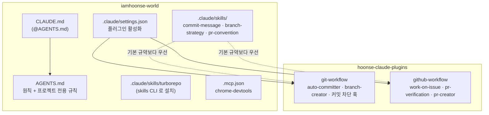
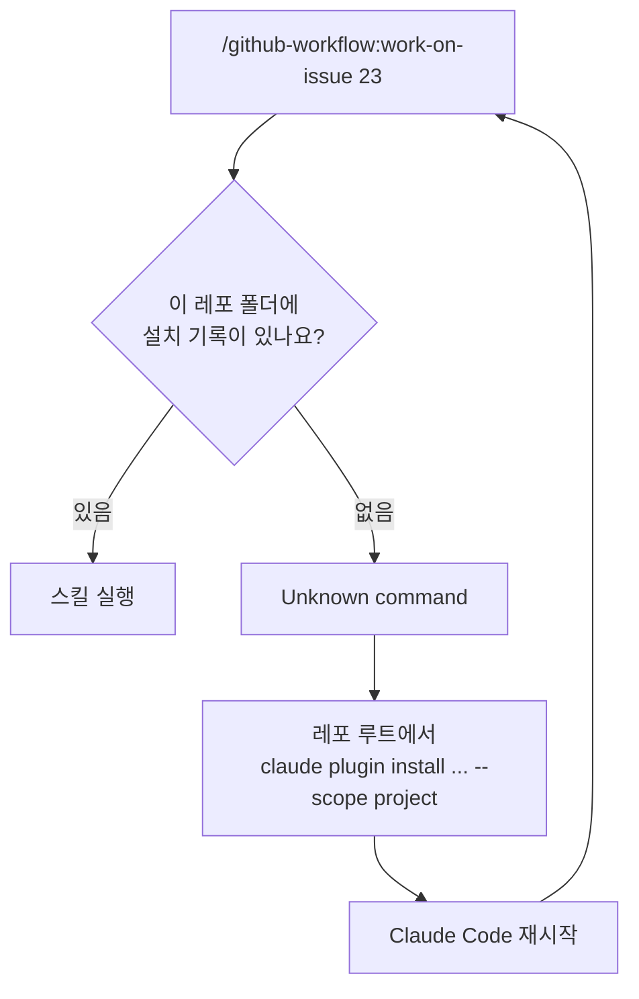
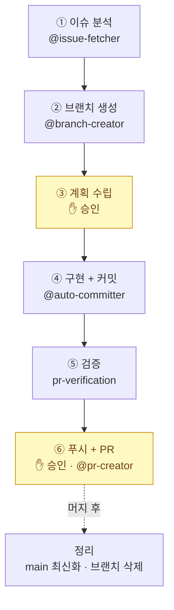
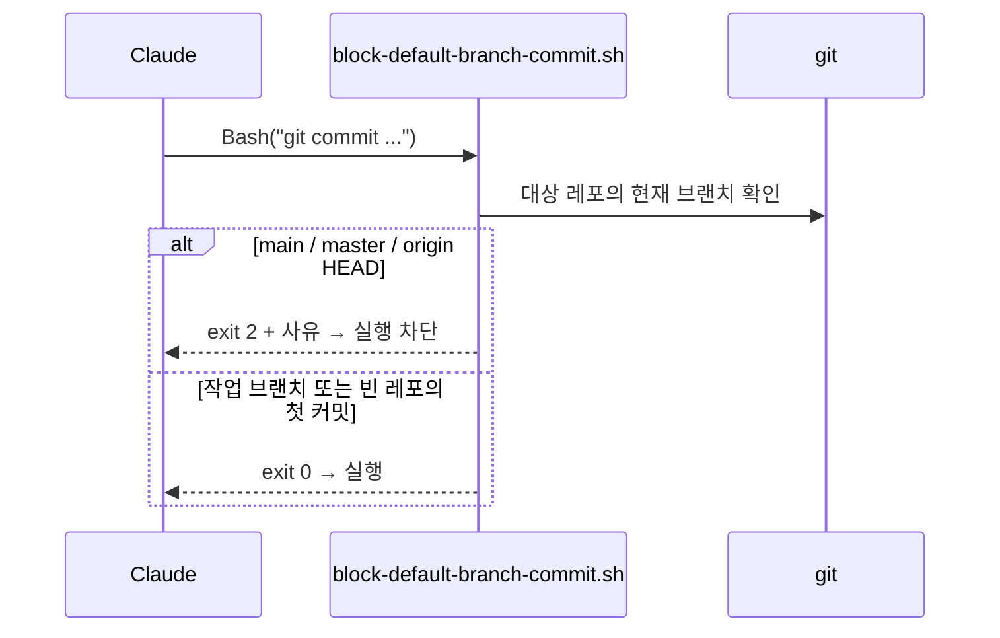
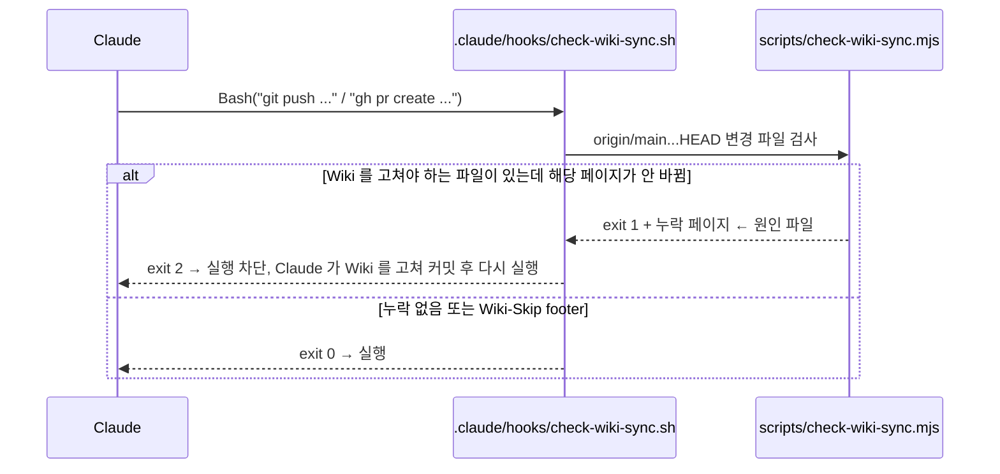

# AI Workflow

이 레포는 **Claude Code 와 함께 개발하는 것을 전제**로 설계했어요.
작업 규칙은 문서로, 반복 절차는 플러그인으로, 꼭 지켜야 하는 규칙은 훅으로 강제해요.

## 구성 요소



| 구성 요소      | 역할                                                                         |
| -------------- | ---------------------------------------------------------------------------- |
| `AGENTS.md`    | 여러 AI 도구가 함께 참고하는 기준 문서. `CLAUDE.md` 는 이를 import 만 해요   |
| 플러그인       | 이슈 → PR 까지의 반복 절차                                                   |
| 레포 규약 스킬 | 커밋/브랜치/PR 형식 등 이 레포만의 차이                                      |
| 훅             | 규칙이 아니라 **강제**가 필요한 것 (`main` 직접 커밋 차단, 커밋 메시지 검사) |
| MCP            | 브라우저 등 외부 도구 연결                                                   |

## 공통 플로우의 플러그인화

이 레포에서 다듬은 개발 플로우는 다른 프로젝트에서도 쓸 수 있도록 별도 레포의
플러그인 마켓플레이스 [hoonse-claude-plugins](https://github.com/iamhoonse-dev/hoonse-claude-plugins) 로 옮겼어요.

- **왜 별도 레포인가요?** 마켓플레이스는 설치할 때 레포 전체를 받아요. 개인 사이트 코드와 분리하는 편이 가벼워요.
- **어떻게 켜나요?** `.claude/settings.json` 에 마켓플레이스와 플러그인을 선언해 두었어요. 다만 이건 켜 두는 설정이고, 실제 설치는 [레포 폴더마다 한 번](#설치--업데이트) 해야 해요.

```json
{
  "extraKnownMarketplaces": {
    "hoonse-claude-plugins": {
      "source": {
        "source": "github",
        "repo": "iamhoonse-dev/hoonse-claude-plugins"
      }
    }
  },
  "enabledPlugins": {
    "git-workflow@hoonse-claude-plugins": true,
    "github-workflow@hoonse-claude-plugins": true
  }
}
```

### 설치 / 업데이트

Claude Code 의 플러그인 설치 기록은 **레포(폴더)마다 따로** 남아요.
다른 레포에 설치했더라도 이 레포에서는 스킬이 등록되지 않아 `Unknown command` 가 날 수 있어요.



레포 루트에서 실행하고, Claude Code 를 재시작해요.

```sh
claude plugin marketplace add iamhoonse-dev/hoonse-claude-plugins   # 마켓플레이스가 없을 때만
claude plugin install git-workflow@hoonse-claude-plugins --scope project
claude plugin install github-workflow@hoonse-claude-plugins --scope project
```

- **설치 확인**: 세션에서 `/github-workflow:` 를 입력해 자동완성에 스킬이 보이면 돼요.
  - `claude plugin list` 는 어느 레포의 설치인지 보여주지 않아요. 정확히 보려면 `~/.claude/plugins/installed_plugins.json` 의 `projectPath` 를 확인해요.
- **업데이트**: `claude plugin marketplace update hoonse-claude-plugins` 후, **이 레포 폴더에서** `claude plugin update <플러그인>@hoonse-claude-plugins` 를 실행하고 재시작해요.
- 설치하면 `.claude/settings.json` 의 키 순서가 바뀔 수 있어요. 내용이 같으면 `git checkout -- .claude/settings.json` 으로 되돌려요.
- `Unknown command` 가 나면 먼저 `/<플러그인>:<스킬>` 형식인지, 그다음 이 레포 폴더에 설치됐는지 확인해요.

## `/github-workflow:work-on-issue` — 이슈에서 PR 까지

작업은 **항상 이슈부터** 시작해요. `📋 새 할 일` 이슈를 만들고 `/github-workflow:work-on-issue <번호>` 를 실행하면 6단계로 진행돼요.

> 플러그인 스킬은 `/<플러그인>:<스킬>` 형식으로만 호출돼요. `/work-on-issue` 처럼 플러그인 이름을 빼면 `Unknown command` 오류가 나요.



### 확인 정책: "주요 지점만"

모든 단계에서 확인을 받으면 흐름이 자주 끊겨요. 이 레포는 `AGENTS.md` 에서 확인 지점을 정해요.

- **계획 승인** (③)
- **외부에 반영되는 작업 직전** — 푸시, PR 생성, 레포 설정/라벨 변경, 원격 브랜치 삭제, 이슈/PR 닫기 등
- 그 밖의 단계는 결과를 보고하고 이어서 진행해요.

## 규약을 찾는 순서

플러그인의 규약은 어느 프로젝트에서나 쓸 수 있는 **범용 기본값**이에요. 에이전트는 아래 순서로 규약을 찾고 처음 찾은 것을 따라요.

| 순서 | 위치                             | 이 레포에서는                      |
| ---- | -------------------------------- | ---------------------------------- |
| 1    | `.claude/skills/<규약>/SKILL.md` | ✅ 여기에 레포 규약을 둬요         |
| 2    | `CLAUDE.md` / `AGENTS.md`        | 규약 요약 표                       |
| 3    | 기존 기록, PR 템플릿             | `.github/pull_request_template.md` |
| 4    | 플러그인 기본 규약               | —                                  |

### 이 레포의 규약

| 규약              | 내용                                                                                    |
| ----------------- | --------------------------------------------------------------------------------------- |
| `commit-message`  | Conventional Commits + scope(앱/패키지 디렉토리 이름), 한국어 명사형 요약, `Refs #번호` |
| `branch-strategy` | trunk-based, 최신 `main` 에서 `<type>/<short-description>`                              |
| `pr-convention`   | PR 템플릿 전 항목 작성, 이슈의 작업 유형 라벨을 PR 에도 부착                            |

예시:

```text
feat(web): 글 목록 페이지 추가
fix(eslint-config): import 순서 규칙 수정
chore: Turborepo 버전 업데이트
```

## `main` 직접 커밋 차단 훅

`git-workflow` 플러그인은 `PreToolUse` 훅으로 Claude 의 Bash 명령을 검사해요.



- `git -C <dir> commit`, `cd <dir> && git commit` 도 대상 레포를 판별해 검사해요.
- 사용자가 명시적으로 허락한 경우에만 `GIT_WORKFLOW_ALLOW_DEFAULT_BRANCH_COMMIT=1` 로 우회해요.

## Wiki 갱신 검사 훅

"구조나 툴체인을 바꾸면 Wiki 도 함께 고친다"(AGENTS.md 9장)는 규칙을 AI 의 판단에 맡기지 않고, 프로젝트 훅으로 **확정적으로** 검사해요.
훅은 Wiki 내용을 대신 써 주지는 못하지만, 빠뜨린 페이지를 찾아 push / PR 생성을 막고 알려 줘요.



- **검사 시점**: 커밋마다가 아니라 `git push` / `gh pr create` 직전이에요. 코드 커밋과 문서 커밋을 나누는 작업 흐름을 깨지 않으려고요.
- **검사 기준**: 스크립트의 `RULES` (파일 glob → 후보 페이지). AGENTS.md 9장의 표와 같은 내용이고, 후보 페이지 중 하나만 바뀌어도 통과해요.

| 바꾸는 파일                                                                      | 고쳐야 하는 페이지                              |
| -------------------------------------------------------------------------------- | ----------------------------------------------- |
| `packages/**`, `turbo.json`, `pnpm-workspace.yaml`                               | `Architecture.md`                               |
| 루트 `package.json`, `.nvmrc`, Prettier 설정, `commitlint.config.mjs`, `.husky/` | `Toolchain.md`                                  |
| `.claude/settings.json`, `.claude/skills/`, `.claude/hooks/`, `skills-lock.json` | `AI-Workflow.md`                                |
| `.mcp.json`                                                                      | `AI-Workflow.md` 또는 `Browser-Verification.md` |
| `.github/**`                                                                     | `GitHub-Automation.md`                          |

- **예외**: Wiki 에 반영할 내용이 정말 없으면 커밋 footer 에 `Wiki-Skip: <이유>` 를 남겨요. 이유가 이력에 남아요.
- jq / node 가 없거나 스크립트가 오류를 내면 경고만 하고 통과해요. (도구 문제로 작업이 막히지 않게)
- 사람이 만든 커밋은 이 훅이 잡지 못해서, PR 에서도 같은 스크립트로 검사해요. ([GitHub Automation](GitHub-Automation#wiki-갱신-검사-pr))

## Agent Skills 관리

외부 스킬은 [skills CLI](https://github.com/vercel-labs/skills) 로 **프로젝트 범위**에 설치하고, 스킬 파일과 `skills-lock.json` 을 모두 커밋해요.

```sh
export DISABLE_TELEMETRY=1
npx skills add vercel/turborepo --skill turborepo -a claude-code -y
```

- 공식 스킬을 우선하고, 설치/업데이트 후 커밋 전에 **내용을 직접 읽고** 확인해요. (스킬은 AI 가 그대로 따르는 지침이에요)
- 현재 설치된 스킬: `turborepo` (`vercel/turborepo`) — 설치된 버전의 번들 문서를 먼저 읽도록 안내해요.

## MCP 와 민감 정보

- 공용 MCP 설정은 `.mcp.json` 에 커밋해요.
- 토큰은 값을 직접 쓰지 않고 `${ENV_VAR}` 로 참조하고, 실제 값은 각자 셸 환경변수에 둬요.

```json
"env": { "API_TOKEN": "${SOME_SERVICE_TOKEN}" }
```

- 개인용 MCP 는 `claude mcp add --scope local` 로 추가해 레포에 남기지 않아요.
- 브라우저 검증용 MCP 는 [Browser Verification](Browser-Verification) 을 참고해요.
