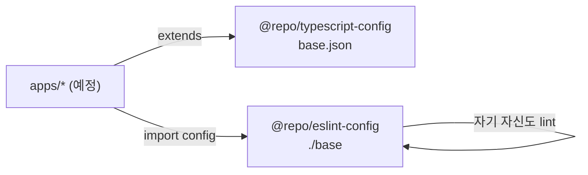
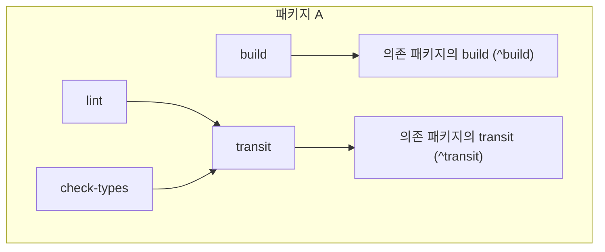

# Architecture

## 레포 구조

```text
iamhoonse-world/
├── apps/                      # 앱 (예정)
├── packages/
│   ├── typescript-config/     # @repo/typescript-config — 공용 tsconfig
│   └── eslint-config/         # @repo/eslint-config — 공용 ESLint (flat config)
├── docs/wiki/                 # 이 Wiki 의 원본
├── .claude/
│   ├── settings.json          # 플러그인 활성화
│   └── skills/                # 레포 규약 + 설치한 스킬
├── .github/                   # 이슈 양식, PR 템플릿, 워크플로우
├── .mcp.json                  # 공용 MCP 서버 설정
├── AGENTS.md / CLAUDE.md      # AI 에이전트 작업 규칙
├── turbo.json                 # 태스크 정의
└── pnpm-workspace.yaml        # apps/*, packages/*
```

## 패키지 관계



- 공용 설정은 `@repo/*` 이름의 내부 패키지로 두고, 앱이 `workspace:*` 로 가져다 써요.
- 앱/패키지는 서로의 내부 파일을 직접 참조하지 않고, 패키지의 `exports` 로만 사용해요.

### @repo/typescript-config

`base.json` 하나를 제공해요. 주요 옵션은 다음과 같아요.

| 옵션                          | 값         | 이유                                           |
| ----------------------------- | ---------- | ---------------------------------------------- |
| `strict`                      | `true`     | 기본 타입 안정성                               |
| `noUncheckedIndexedAccess`    | `true`     | 배열/객체 인덱싱 결과에 `undefined` 를 포함    |
| `module` / `moduleResolution` | `NodeNext` | Node 의 ESM 해석 규칙을 그대로 따름            |
| `target` / `lib`              | `ES2024`   | Node 26 이 지원하는 최신 문법                  |
| `isolatedModules`             | `true`     | 파일 단위 트랜스파일러(esbuild, SWC 등)와 호환 |

### @repo/eslint-config

ESLint 10 의 flat config 배열을 `./base` 로 내보내요.

- `@eslint/js` recommended + `typescript-eslint` recommended
- `eslint-config-prettier` 로 포매팅 규칙은 Prettier 에 맡김
- `eslint-plugin-turbo` 의 `turbo/no-undeclared-env-vars` — `turbo.json` 에 선언하지 않은 환경변수를 쓰면 캐시가 깨질 수 있어 경고

## Turborepo 태스크

태스크 스크립트는 **각 패키지의 `package.json`** 에 두고, 루트 `package.json` 은 `turbo run <task>` 로 위임만 해요.



| 태스크        | 설정                                    | 의미                                              |
| ------------- | --------------------------------------- | ------------------------------------------------- |
| `build`       | `dependsOn: ["^build"]`, `outputs` 지정 | 의존 패키지를 먼저 빌드하고 결과물을 캐시         |
| `transit`     | `dependsOn: ["^transit"]`               | 실제 스크립트가 없는 **Transit Node**             |
| `lint`        | `dependsOn: ["transit"]`                | 의존 패키지가 바뀌면 다시 실행되지만, 병렬로 실행 |
| `check-types` | `dependsOn: ["transit"]`                | 위와 같음                                         |
| `dev`         | `cache: false`, `persistent: true`      | 캐시하지 않는 장기 실행 태스크                    |

### Transit Node 를 쓰는 이유

`lint` 나 `check-types` 를 `^lint` 에 의존시키면 의존 패키지를 **순서대로** 기다려야 해서 느려요.
의존을 아예 빼면 의존 패키지의 소스가 바뀌어도 **캐시가 무효화되지 않아요.**

`transit` 처럼 스크립트 없는 태스크를 사이에 두면, 의존 그래프(캐시 해시)는 유지하면서 실행은 병렬로 할 수 있어요.

> Turborepo 설정을 바꿀 때는 설치된 버전의 번들 문서(`node_modules/turbo/docs`)를 먼저 확인해요. (`turborepo` 스킬)
