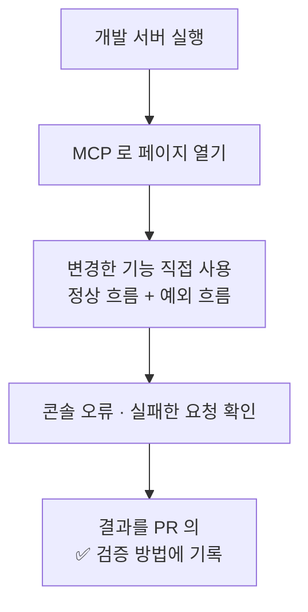

# Browser Verification

화면이나 동작이 있는 변경은 **AI 가 브라우저에서 직접 사용해 보고** PR 을 올려요.
[Chrome DevTools MCP](https://github.com/ChromeDevTools/chrome-devtools-mcp) 로 Claude Code 가 Chrome 을 조작해요.

## 구성

```json
{
  "mcpServers": {
    "chrome-devtools": {
      "command": "npx",
      "args": ["-y", "chrome-devtools-mcp@latest"]
    }
  }
}
```

- `.mcp.json` 에 두고 커밋해서, 레포를 받은 사람도 같은 설정을 써요.
- `--autoConnect`(이미 실행 중인 Chrome 에 붙기)는 쓰지 않고, **전용 프로필로 별도 Chrome** 을 띄워요.
  - macOS 에서는 개인정보 보호(TCC) 때문에 기존 Chrome 프로필의 `DevToolsActivePort` 를 읽지 못해 연결이 실패했어요.
  - 전용 프로필은 평소 쓰는 브라우저와 분리되어 있어 테스트가 개인 탭에 영향을 주지 않아요.
- 레포 폴더에서 `npx` 로 실행되므로 **Node 26 환경**에서 Claude Code 를 띄워야 해요. ([Toolchain](Toolchain) 의 npm / npx 충돌 참고)

## 검증 절차



## 사람과 AI 의 역할

| 사람이 직접 해요       | AI 가 해요                                     |
| ---------------------- | ---------------------------------------------- |
| 로그인, 2단계 인증     | 페이지 이동, 클릭, 입력, 스냅샷, 스크립트 실행 |
| 결제 등 민감 정보 입력 | 콘솔 / 네트워크 확인                           |
| 다른 탭 사용           | **테스트 대상 탭만** 조작                      |

## 실제 사례

이 레포의 이슈 양식과 라벨 자동화도 이 방식으로 검증했어요.

- 테스트 이슈를 브라우저에서 양식으로 작성 → 라벨이 붙는지 확인
- GitHub 마크다운 편집기가 목록을 자동으로 이어 쓰는 문제는, `evaluate_script` 로 textarea 값을 직접 설정해 해결했어요.
- 테스트용 이슈는 결과를 댓글로 남기고 `not planned` 로 닫았어요.
