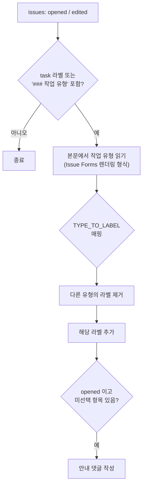
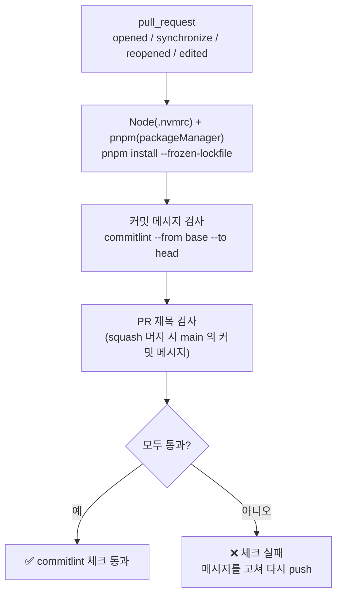
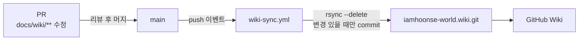

# GitHub Automation

## 이슈 양식

빈 이슈는 막아 두고(`blank_issues_enabled: false`), 세 가지 양식과 Discussions 링크만 제공해요.

| 양식         | 라벨          | 용도                                  |
| ------------ | ------------- | ------------------------------------- |
| 🐛 버그 제보 | `bug`         | 재현 방법, 발생 빈도, 사용 환경 등    |
| 💡 기능 제안 | `enhancement` | 외부에서의 기능 제안                  |
| 📋 새 할 일  | `task` + 자동 | 내부 작업. 작업 유형에 따라 라벨 자동 |
| 💬 자유 주제 | —             | GitHub Discussions 로 연결            |

드롭다운의 첫 항목은 `⚠️ 선택해 주세요` 예요. Issue Forms 의 드롭다운은 기본값 없이 첫 항목이 선택된 것처럼 보이기 때문에, 선택하지 않은 상태를 구분하려고 넣었어요.

## 작업 유형 라벨 자동화

`.github/workflows/issue-task-type-labeler.yml` 이 `📋 새 할 일` 이슈의 "작업 유형"을 읽어 라벨을 붙여요.

| 작업 유형                  | 라벨              |
| -------------------------- | ----------------- |
| 신규 기능 개발 / 기능 개선 | `enhancement`     |
| 리팩토링                   | `refactor`        |
| 인프라 / 배포              | `infra`           |
| 프로젝트 설정 / 관리       | `project-setting` |
| 문서화                     | `documentation`   |
| 기타                       | (없음)            |

- 이슈를 수정해 작업 유형을 바꾸면 라벨도 다시 맞춰요.
- `actions/github-script` 로 API 를 직접 호출하고, 권한은 `issues: write` 만 줘요.
- 선택지를 바꿀 때는 `task.yml` 과 워크플로우의 `TYPE_TO_LABEL` / `PLACEHOLDER` 를 **함께** 수정해요.

## PR 템플릿

`.github/pull_request_template.md` 는 리뷰어가 diff 를 보기 전에 맥락을 파악할 수 있도록 구성했어요.

| 섹션          | 특히 신경 쓰는 것                                          |
| ------------- | ---------------------------------------------------------- |
| 🔗 관련 이슈  | `Closes #번호` 로 머지 시 이슈 자동 종료                   |
| 🎯 영향 범위  | **위험도**(🟢/🟡/🔴)와 **하위 호환성**                     |
| ✅ 검증 방법  | **검증한 것과 검증하지 못한 것을 구분**, 머지 후 확인 절차 |
| 💬 리뷰어에게 | **함께 수정해야 하는 곳**                                  |

PR 에는 연결된 이슈의 작업 유형 라벨을 그대로 붙여요.

## 커밋 메시지 검사 (PR)

`.github/workflows/commitlint.yml` 이 PR 마다 커밋 메시지를 [Toolchain](Toolchain) 의 로컬 훅과 **같은 규칙**(`commitlint.config.mjs`)으로 다시 검사해요.
로컬 훅이 막지 못하는 커밋(`--no-verify`, 훅 미설치 환경, GitHub 웹 편집)을 `main` 에 들어오기 전에 걸러요.

- PR 제목도 검사해요. 레포가 squash 머지를 허용하는데, squash 하면 PR 제목이 그대로 `main` 의 커밋 메시지가 되기 때문이에요.
- PR 제목은 `env` 로 넘겨서 `run` 스크립트에 직접 넣지 않아요. (스크립트 인젝션 방지)
- 권한은 `contents: read` 만 줘요. CI 에서는 `HUSKY=0` 으로 훅 설치를 건너뛰어요.
- 체크가 실패하면 `git rebase -i` / `git commit --amend` 로 메시지를 고친 뒤 다시 push 해요.

## 레포 설정

- **머지 시 원격 브랜치 자동 삭제** (`deleteBranchOnMerge`) — 로컬은 `main` 최신화 후 `git branch -d` 로 정리해요.
- 자유 논의는 **Discussions** 로 분리했어요.

## Wiki 동기화

이 Wiki 는 웹에서 직접 편집하지 않고, 메인 레포의 `docs/wiki/` 를 원본으로 관리해요.

- **왜 이렇게 하나요?** 문서도 코드처럼 PR 로 리뷰하고, 구조를 바꾸는 PR 에서 문서도 함께 고칠 수 있어요.
- Wiki 를 웹에서 직접 고치면 다음 동기화 때 덮어써져요.
- 파일 이름이 페이지 이름이 돼요. (`AI-Workflow.md` → "AI Workflow", `_Sidebar.md` / `_Footer.md` 는 공통 영역)
