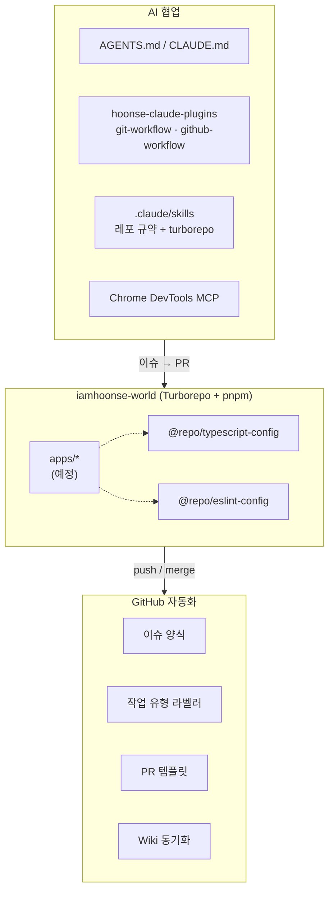

# iamhoonse-world

> 개인 프로젝트 **iamhoonse-world** 의 구조, 동작 방식, 개발 워크플로우를 정리한 Wiki 예요.

아직 앱은 없지만, 앱을 올리기 전에 **모노레포 기반, 툴체인, AI 협업 워크플로우, GitHub 자동화**를 먼저 다져 두었어요.
이 Wiki 는 그 과정에서 내린 결정과 이유를 기록해요.

## 한눈에 보기



## 기술 스택

| 영역      | 사용 기술                                                                 |
| --------- | ------------------------------------------------------------------------- |
| 모노레포  | Turborepo 2.11, pnpm 12 workspace                                         |
| 런타임    | Node.js 26 LTS (`devEngines` 로 자동 설치)                                |
| 언어/품질 | TypeScript 6.0, ESLint 10 (flat config, typescript-eslint), Prettier 3    |
| AI 협업   | Claude Code, 자체 플러그인 마켓플레이스, Agent Skills, MCP                |
| 자동화    | GitHub Issue Forms, GitHub Actions (`actions/github-script`), Wiki 동기화 |

## 페이지 안내

| 페이지                                       | 내용                                                   |
| -------------------------------------------- | ------------------------------------------------------ |
| [Architecture](Architecture)                 | 모노레포 구조, 패키지 관계, Turborepo 태스크 그래프    |
| [Toolchain](Toolchain)                       | Node / pnpm / TypeScript 버전 관리와 그 이유           |
| [AI Workflow](AI-Workflow)                   | 플러그인 기반 이슈 → PR 흐름, 규약, 훅, 스킬, MCP      |
| [GitHub Automation](GitHub-Automation)       | 이슈 양식, 라벨 자동화, PR 템플릿, Wiki 동기화         |
| [Browser Verification](Browser-Verification) | Chrome DevTools MCP 로 브라우저에서 직접 검증하는 방법 |

## 바로 시작하기

```sh
npm i -g pnpm@12   # Corepack 대신 직접 설치 (Toolchain 참고)
pnpm install
pnpm build && pnpm lint && pnpm check-types
```
