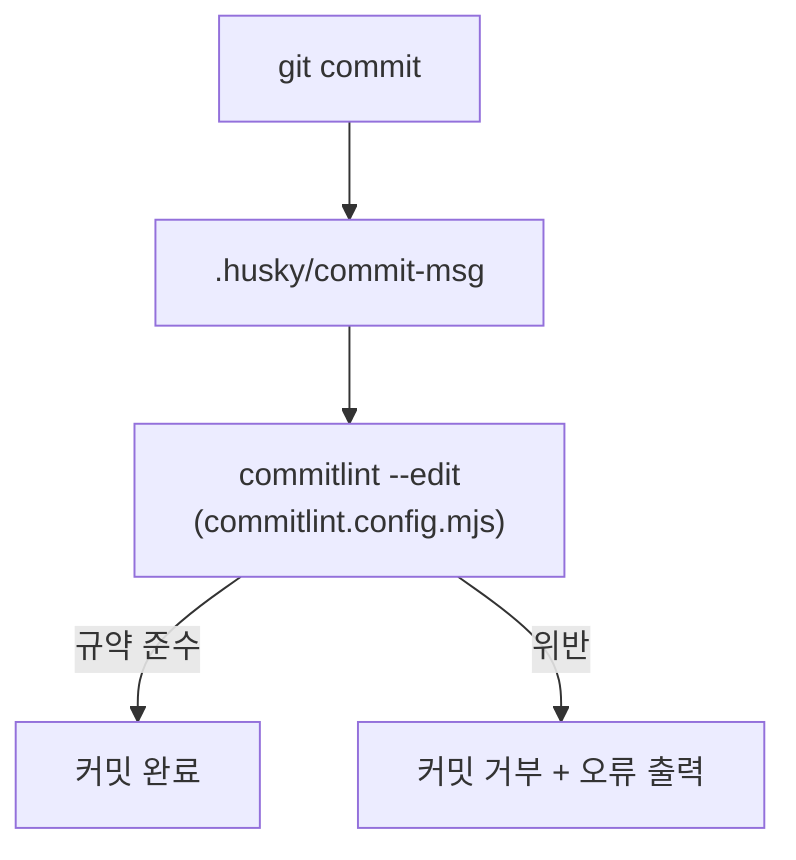

# Toolchain

## 버전 한눈에 보기

| 대상       | 버전    | 명시 위치                                                        |
| ---------- | ------- | ---------------------------------------------------------------- |
| Node.js    | 26 LTS  | `.nvmrc`, `package.json` 의 `engines.node`, `devEngines.runtime` |
| pnpm       | 12.18.0 | `package.json` 의 `packageManager`                               |
| TypeScript | 6.0.x   | 루트 / `@repo/eslint-config` 의 `devDependencies`                |
| Turborepo  | 2.11.x  | 루트 `devDependencies`                                           |
| ESLint     | 10.x    | `@repo/eslint-config` 의 `devDependencies`                       |
| Prettier   | 3.x     | 루트 `devDependencies`                                           |
| husky      | 9.x     | 루트 `devDependencies`                                           |
| commitlint | 21.x    | 루트 `devDependencies`                                           |

> Node 버전을 바꿀 때는 위 세 곳을 **함께** 수정해요.

## Node.js 26 — 세 겹으로 고정하기

```json
{
  "engines": { "node": ">=26" },
  "devEngines": {
    "runtime": { "name": "node", "version": "^26.13.0", "onFail": "download" }
  }
}
```

| 장치                 | 누가 읽나요         | 효과                                                         |
| -------------------- | ------------------- | ------------------------------------------------------------ |
| `.nvmrc`             | nvm                 | `nvm use` 로 셸의 Node 를 맞춤                               |
| `engines.node`       | 패키지 매니저, 사람 | 지원 범위를 선언                                             |
| `devEngines.runtime` | pnpm (npm 도 검사)  | pnpm 이 **지정된 Node 를 자동으로 내려받아** 스크립트를 실행 |

`devEngines.runtime` + `onFail: "download"` 덕분에 셸의 Node 버전과 상관없이 `pnpm build` 같은 프로젝트 스크립트는 Node 26 으로 실행돼요.

### ⚠️ npm / npx 와의 충돌

`onFail: "download"` 는 **pnpm 전용** 기능이에요. npm 은 `devEngines` 를 검사만 하고, 조건이 맞지 않으면 `EBADDEVENGINES` 오류로 종료해요.

- 레포 안에서 Node 22 로 `npm` / `npx` 를 실행하면 실패해요.
- `.mcp.json` 의 MCP 서버도 레포 폴더에서 `npx` 로 실행되기 때문에, Claude Code 를 Node 22 환경에서 띄우면 **MCP 연결이 `CONNECTION_CLOSED` 로 실패**해요.

해결: 레포에서는 Node 26 을 쓰도록 셸을 맞춰요.

```sh
nvm use                       # .nvmrc 기준으로 전환
# 또는 ~/.zshrc 에 nvm 의 load-nvmrc 자동 전환 훅을 추가
```

## pnpm 12 — Corepack 대신 직접 설치

```sh
npm i -g pnpm@12
```

Node 22 에 번들된 Corepack(0.33)은 pnpm 12 를 실행하지 못해요. (`MODULE_NOT_FOUND ... pnpm.cjs`)
셸의 기본 Node 가 22 라면 `pnpm` 이 Corepack 쪽을 가리켜 같은 오류가 날 수 있어서, Node 26 에서 직접 설치한 pnpm 을 써요.

## TypeScript 6.0 고정

TypeScript 는 `~6.0.3` 으로 고정했어요. `typescript-eslint` 가 지원하는 범위가 현재 `<6.1` 이기 때문이에요.
7.x 로 올리려면 `typescript-eslint` 의 지원 여부를 먼저 확인해요.

## ESLint 10 + Prettier

- ESLint 는 flat config(`eslint.config.js`)만 사용해요.
- 포매팅은 Prettier 가 전담하고, ESLint 는 `eslint-config-prettier` 로 충돌하는 규칙을 꺼요.
- Prettier 설정은 기본값(`.prettierrc.json` 이 `{}`)이에요.
- `.prettierignore` 에서 `pnpm-lock.yaml`, `skills-lock.json`, `.agents/`, `.claude/` 는 제외해요. (도구가 생성하는 파일)

| 명령                | 설명              |
| ------------------- | ----------------- |
| `pnpm format`       | 전체 포맷         |
| `pnpm format:check` | 포맷 검사만       |
| `pnpm lint`         | 전체 린트 (turbo) |
| `pnpm check-types`  | 전체 타입 체크    |

## 커밋 메시지 검사 — husky + commitlint

AI 와 사람이 따르는 커밋 규약을 **Git 훅으로 강제**해요. 규약에 맞지 않는 메시지는 로컬에서 커밋되지 않아요.



- `pnpm install` 때 `prepare` 스크립트(`husky`)가 `core.hooksPath` 를 `.husky/_` 로 설정해요.
- 규칙은 `@commitlint/config-conventional` 을 기반으로 레포 규약에 맞춰 덮어써요.

| 규칙                   | 값                                                               |
| ---------------------- | ---------------------------------------------------------------- |
| `type-enum`            | feat, fix, refactor, perf, test, docs, style, build, ci, chore   |
| `scope-enum`           | `apps/*`, `packages/*` 디렉토리 이름을 동적으로 수집 (생략 가능) |
| `header-max-length`    | 72                                                               |
| `subject-case`         | 끔 (영문 대문자로 시작하는 한국어 요약 허용)                     |
| `body-max-line-length` | 끔 (한국어 본문, URL)                                            |

- 앱/패키지를 추가하면 scope 목록이 자동으로 늘어나요.
- 한국어 명사형 요약처럼 기계적으로 검사할 수 없는 부분은 `commit-message` 스킬로 안내해요.
- IDE 등 GUI 에서 커밋할 때 `pnpm` 을 찾지 못하면 `~/.config/husky/init.sh` 에서 nvm 을 불러와요.
- 로컬 훅은 `--no-verify` 등으로 건너뛸 수 있어서, PR 에서도 같은 설정으로 한 번 더 검사해요. ([GitHub Automation](GitHub-Automation#커밋-메시지-검사-pr))
